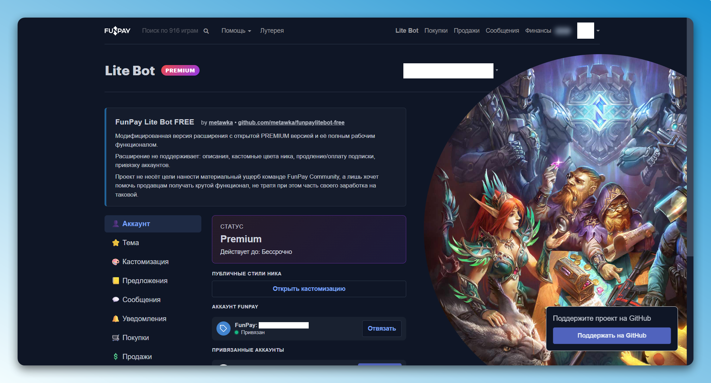
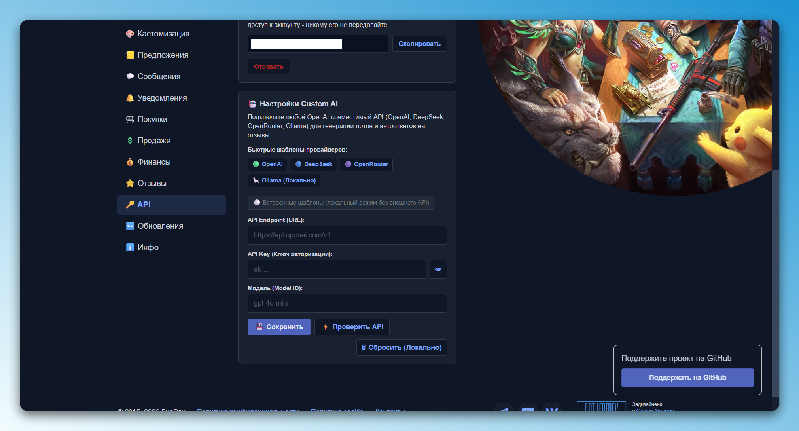
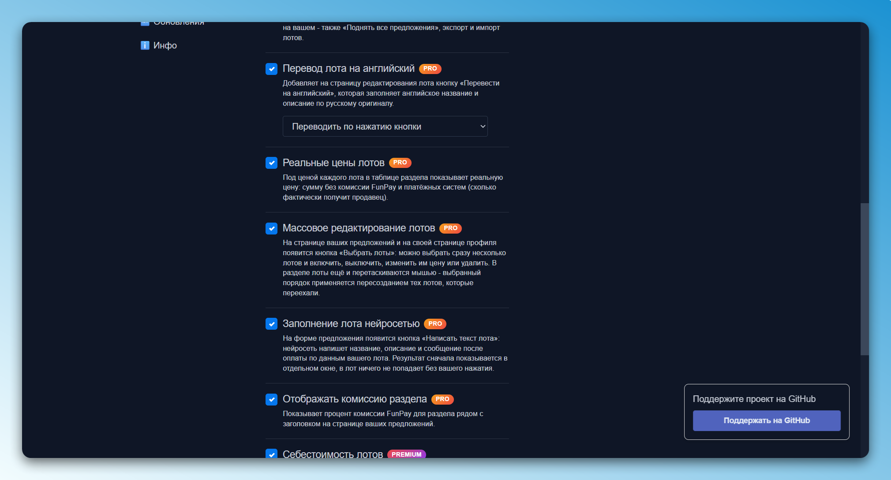
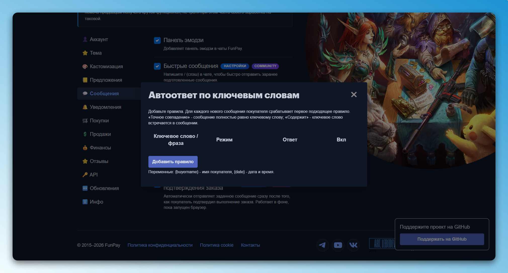
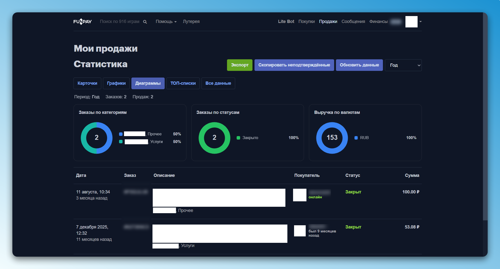

# FunPay Lite Bot FREE

Бесплатная версия расширения FunPay Lite Bot со всеми открытыми функциями тарифа PREMIUM.

---

## Возможности

В расширении разблокированы все функции оригинального расширения:

- **Бессрочный PREMIUM**: все функции тарифов Pro, Premium и Community.
- **Подключение любого ИИ**: прямо в интерфейсе можно настроить свой API для генерации лотов и ответов на отзывы (OpenAI, DeepSeek, OpenRouter или локальная Ollama).
- **Массовое редактирование лотов**: быстрое изменение цен нескольких предложений сразу, включение и отключение.
- **Реальные цены и комиссии**: показ суммы, которую фактически получит продавец на руки с вычетом всех комиссий FunPay и платёжных систем.
- **Автоответы и сообщения**: правила ответов по ключевым словам, приветствие новых покупателей, автоответ после подтверждения оплаты.
- **Статистика продаж**: графики выручки по валютам, круговые диаграммы по категориям и статусам, экспорт списка заказов.
- **Темы оформления**: встроенные стили (тёмная, Firewatch, Red Moon) и добавление кастомных тем оформления.

---

## Скриншоты

### PREMIUM


### CUSTOM AI


### LOTS SETUP


### AUTO REPLY


### ANALITYCS AND STATS


---

## Установка

1. Скачайте проект кнопкой **Code** -> **Download ZIP** и распакуйте архив в удобную папку (либо склонируйте через git):
   ```bash
   git clone https://github.com/metawka/funpaylitebot-free.git
   ```
2. Откройте в браузере раздел расширений: `chrome://extensions/`
3. В правом верхнем углу включите переключатель **«Режим разработчика»**.
4. Нажмите **«Загрузить распакованное расширение»** в левом верхнем углу.
5. Укажите папку с файлами расширения.
6. Перейдите на FunPay. В верхнем списке появится пункт меню **Lite Bot**.

---

## Настройка своего ИИ

Для автоматического составления привлекательных лотов и дружелюбных ответов покупателям можно подключить любую языковую модель:

1. Откройте настройки Lite Bot на странице FunPay и перейдите в раздел **«API»**.
2. В блоке **«Настройки Custom AI»** выберите удобный готовый шаблон:
   - **OpenAI** (модель `gpt-4o-mini`)
   - **DeepSeek** (модель `deepseek-chat`)
   - **OpenRouter** (любые модели каталога)
   - **Ollama** (для работы на своём компьютере через `http://localhost:11434/v1`)
3. Вставьте ваш API ключ и при необходимости укажите название модели.
4. Нажмите **«Проверить API»**, чтобы убедиться в ответе нейросети, а затем **«Сохранить»**.

Перейти в это меню можно и прямо во время редактирования лота: в окне генерации добавлена кнопка **«Настройки ИИ»**.

---

## Поддержка проекта

Если расширение оказалось полезным, поддержите проект звездой на [GitHub](https://github.com/metawka/funpaylitebot-free/stargazers).
